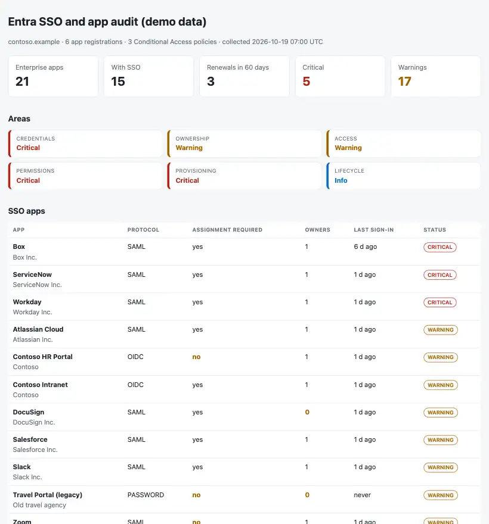

# Entra SSO App Audit

A monthly review of the **enterprise apps and app registrations in Microsoft Entra ID**: certificates and secrets about to expire, apps nobody owns, apps any user can open without MFA, permissions that are far too wide, outside apps with consent for every user, and SCIM provisioning jobs that stopped. One read-only Graph export, one Python command, and the answer to: **which app will break next, and which one is a risk nobody has looked at?**

Python 3.10+, standard library only. PowerShell export script (Microsoft Graph). Runs with fictional demo data out of the box.



## Why

Single sign-on concentrates access in one place, which is good, but the details are spread over hundreds of enterprise apps. The same few problems come back:

- a **SAML signing certificate** expires and a SaaS app stops accepting logons at 09:00,
- a **client secret** expires and a nightly job fails silently, or a secret created "for ten years" sits in a script,
- an app has **no owner**, so nobody renews it or approves access,
- **"Assignment required"** is off, so every user in the tenant can open the app,
- an app is **excluded from the MFA policy** "temporarily",
- a daemon has **Directory.ReadWrite.All** or app-only access to every mailbox,
- an outside app got **consent for all users** to read mail and files,
- **SCIM provisioning** is in quarantine and leavers keep their account in the SaaS app.

This tool lists them in one page, ordered by urgency, with the next step for each, plus a renewal calendar.

## What it checks

| Area | Checks |
|---|---|
| Credentials | SAML signing certificates (warning 60 days, critical 14 days or expired; ignored when a new certificate is already added). Secrets and certificates of app registrations: expiring, expired while the app still signs in (critical) or expired and unused (clean-up), and secrets valid for more than two years. |
| Ownership | App registrations and SSO enterprise apps without owners. |
| Access | SSO apps (SAML, OIDC, password) with "Assignment required" off; SSO apps not covered by an **enabled** Conditional Access policy that requires MFA (report-only and block policies do not count; exclusions do). |
| Permissions | Application permissions that allow directory takeover (critical) or tenant-wide data access (warning); delegated consent for all users to outside apps on risky scopes; third-party apps from unverified publishers; redirect URIs over HTTP or with wildcards. |
| Provisioning | SCIM jobs in quarantine (critical) or failing (warning). Paused jobs are ignored. |
| Lifecycle | SSO apps with no sign-ins in 90 days or never. |

Outputs: `report.html` (single file, light and dark mode), `findings.csv`, `renewals.csv` (every credential ending in the next 180 days, soonest first, with its owners) and `review.md` (Act now / Decide at the review / Clean-up / renewal calendar, ready for the access review).

How to run the review and renew a SAML certificate without an outage: [docs/app-review-runbook.md](docs/app-review-runbook.md).

## Try it

```bash
git clone https://github.com/inigogonzalezgarcia/20-entra-sso-app-audit.git
cd 20-entra-sso-app-audit
python -m ssoaudit demo
```

Open `output/report.html` and `output/review.md`.

The demo is a made-up tenant (`contoso.example`) with 21 enterprise apps and 6 app registrations. Well-known SaaS names are used only as realistic labels; IDs, owners, dates and settings are invented. Faults are placed on purpose: a SAML certificate that expired last week and one that expires in 9 days, a payroll job whose secret expired three days ago, an app with no owner, apps open to every user, an app excluded from the MFA policy, a daemon with `Directory.ReadWrite.All`, a backup connector with app-only access to all mail and files, a PDF tool from an unverified publisher with consent for everyone's mail, an HR provisioning job in quarantine, an insecure redirect URI and an app nobody has used for 200 days.

## Use it with your own tenant

1. Install the Microsoft Graph PowerShell SDK (once):
   ```powershell
   Install-Module Microsoft.Graph.Authentication -Scope CurrentUser
   ```
2. Export. Read-only scopes: `Application.Read.All`, `Directory.Read.All`, `AuditLog.Read.All`, `Policy.Read.All`, `Synchronization.Read.All`:
   ```powershell
   .\scripts\Export-EntraAppInventory.ps1 -OutputPath .\entra_apps.json
   ```
   Options: `-IncludeMicrosoftApps`, `-SkipSignInActivity` (the sign-in activity report needs Entra ID P1/P2), `-SkipProvisioning`. Only the dates of secrets and certificates are exported, never their values.
3. Build the outputs:
   ```bash
   python -m ssoaudit report entra_apps.json --out output
   ```
   Options: `--warning-days 60`, `--critical-days 14`, `--unused-days 90`, `--horizon-days 180`, `--title "CONTOSO · app review"`.

The export contains app names, owners and permission lists. Keep it, and the reports, inside your organisation. Real exports are excluded from Git by `.gitignore`.

## Tests

```bash
python -m unittest discover tests      # or: pip install -r requirements-dev.txt && python -m pytest
```

15 tests: a clean app with no findings, SAML certificate thresholds and rollover, the renewal calendar, secrets expired while in use vs rotated vs unused, long-lived secrets, owners, assignment, MFA coverage (exclusions, report-only and block policies), API-only apps left out of access checks, application permissions, tenant-wide vs single-user consent, redirect URIs, provisioning states, Graph timestamps with seven decimals and the BOM, and the demo end to end (every check fires at least once).

**What has not been tested yet:** the export script against a real tenant. `servicePrincipalSignInActivities` is a **beta** report, and the provisioning job fields (`countSuccessiveCompleteFailures`, quarantine) are read defensively. SCIM provisioning and the finer points of OIDC are the parts of this project I am still learning; the checks on them are deliberately simple.

## Background

Built from my work as a Microsoft 365 Global Admin: integrating SaaS apps in Entra ID with SAML and app registrations, managing Conditional Access and just-in-time admin access, and chasing the certificate that expires on a Monday morning. Written from scratch with fictional data; no employer scripts, data or configuration are used.

## Customisation and contact

Want this adapted to your tenant (your own risky-permission list, Teams or email alerts for the renewal calendar, a scheduled run in Azure Automation, owners pulled from your CMDB)? Get in touch:

- Website (contact form): [inigogonzalezgarcia.github.io](https://inigogonzalezgarcia.github.io/about.html#contacto)
- LinkedIn: [linkedin.com/in/igonzalez93](https://www.linkedin.com/in/igonzalez93)

## License

MIT
